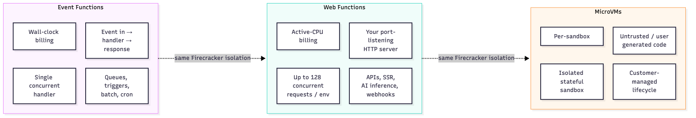
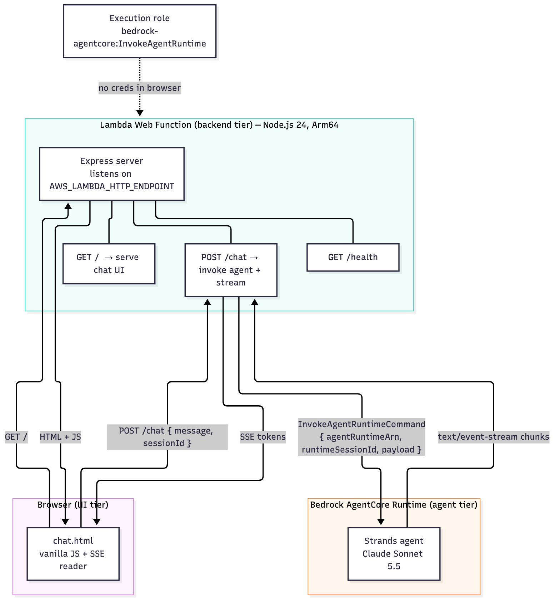
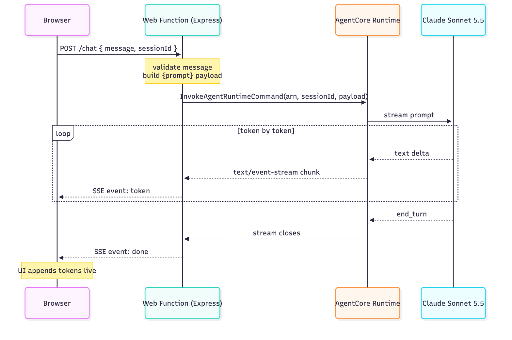

# Serving an Agent to the Browser: AWS Lambda Web Functions + Bedrock AgentCore

If you've ever tried to put a web app on AWS Lambda, you know the ritual: take a
perfectly good Express or FastAPI server, then bend it into an event handler,
bolt on an adapter, wire up API Gateway, and hope the request/response mapping
behaves. **Lambda Web Functions** remove that ritual. You deploy the HTTP server
you already have.

This post introduces Web Functions, covers what they support today, explains
where they fit in the agentic-AI picture, and then walks through a working proof
of concept: a browser chat UI, served by a Web Function, that talks to an agent
running in **Amazon Bedrock AgentCore Runtime**.

---

## What are Lambda Web Functions?

A Lambda Web Function runs a standard, port-listening HTTP server on Lambda — no
event-handler rewrite, no adapter, no framework lock-in. Your code listens on a
port, handles requests, and returns responses, exactly as it would on any host.
The one concession to the platform: Lambda tells your server which host and port
to bind to through the `AWS_LAMBDA_HTTP_ENDPOINT` environment variable.

With this launch, Lambda now has three form factors, all built on the same
Firecracker isolation technology, each for a different programming model:



- **Event Functions** — the Lambda you already know. Event in, handler runs,
  response out. Single concurrent handler per environment, wall-clock billing.
  Ideal for queue consumers, triggers, batch, and cron.
- **Web Functions** — an HTTP-native model. Each execution environment serves up
  to 128 concurrent requests, and you're billed for **active CPU time** rather
  than wall-clock time. Ideal for APIs, server-side rendering, streaming
  endpoints, and AI inference.
- **MicroVMs** — isolated, stateful sandboxes with a customer-managed lifecycle,
  for running untrusted or user-generated code.

They compose. One application might use Event Functions for async backend
processing, Web Functions for the user-facing API and SSR layer, and MicroVMs for
interactive code execution — same account, same operational model.

### Why the billing model matters

Web Functions meter the CPU time your code actually uses. Time spent waiting on a
database query, a downstream API, or an LLM streaming tokens back consumes very
little CPU. For I/O-heavy workloads — and an agent endpoint streaming a response
is about as I/O-heavy as it gets — you're not paying for idle wait. Combined with
up to 128 concurrent requests sharing a warm environment, a burst of traffic
reuses warm capacity instead of mapping one request to one cold environment.

### What languages are supported?

Here's the honest, current answer: **Node.js only, at launch.**

The runtime is Node.js 24 (`nodejs24.x`) on Arm64. The frameworks AWS highlights
— Express, Hono, Fastify, Next.js — are all Node.js. **Python is not supported as
a Web Function yet.** Python remains a first-class managed runtime for *Event*
Functions, but if you want a Python web server (Flask, FastAPI, Django) on
Lambda, you're still in adapter-and-API-Gateway territory for now.

> This matters for the architecture below. Our agent is written in Python (via
> the Strands framework), but it runs in **AgentCore Runtime**, not in the Web
> Function. The Web Function is Node.js and simply *invokes* the agent. The two
> tiers are decoupled, so the Node-only limitation on Web Functions doesn't
> constrain the language of your agent at all.

Also available at launch: VPC connectivity, multi-Region latency-based routing
through a single global URL, and CloudFront origin access control (OAC) so you
can put a CDN in front of a private origin. Regions at launch: N. Virginia, Ohio,
Oregon, Tokyo, and Ireland.

---

## Where Web Functions fit in the agentic-AI world

Agents are a near-perfect workload for this form factor. Consider the shape of an
agent request:

- **It's long and I/O-bound.** The agent calls a model, maybe runs tools, maybe
  queries a knowledge base. Most of that wall-clock time is waiting, not
  computing. Active-CPU billing means you don't pay for the wait.
- **It streams.** Users expect tokens to appear as they're generated. Web
  Functions support native HTTP streaming, so you can forward model output to the
  browser incrementally.
- **It's bursty and concurrent.** Many users, many simultaneous conversations.
  128 concurrent requests per warm environment absorbs bursts without a cold
  start per request.

So where does a Web Function sit relative to the agent itself? **It's the middle
tier** — the HTTP front door between the browser and the agent runtime. A clean
separation of concerns looks like this:

- **Browser** — the UI. Renders chat, reads the stream.
- **Web Function** — the backend. Serves the UI, exposes API routes, holds AWS
  credentials via its execution role, and invokes the agent. Never puts secrets
  in the browser.
- **AgentCore Runtime** — the agent. Runs your framework (Strands, LangGraph,
  etc.) and the model, manages sessions, streams back output.

A common point of confusion worth stating plainly: **a Web Function is not a
UI.** It's a server. It can *serve* a UI (return HTML, serve a static bundle, do
SSR) and it can expose API routes, but it is a backend process. In our POC it
does both — serves the chat page and exposes `/chat` — which keeps the whole
thing a single deployable.

Why not have the browser call AgentCore directly and skip the middle tier?
Because that would mean putting AWS credentials (or a brokered token flow) in the
browser, exposing the agent ARN, and losing a natural place to add auth, rate
limiting, request shaping, and logging. The Web Function is that place.

---

## The proof of concept

Goal: a browser chat UI, served by a Lambda Web Function, that invokes a
Bedrock AgentCore agent and streams the reply back token by token.

### Architecture



Three tiers, one deployable Web Function:

| Tier | What it is | Tech |
| --- | --- | --- |
| UI | `chat.html`, served by the function | vanilla JS, SSE reader |
| Backend | the Web Function | Node.js 24, Express, AWS SDK |
| Agent | the agent in AgentCore Runtime | Python, Strands, Claude Sonnet 5.5 |

Credentials never reach the browser. The Web Function's execution role carries a
single scoped permission, `bedrock-agentcore:InvokeAgentRuntime`, limited to the
one agent ARN.

### The request lifecycle

A single chat turn flows like this:



The browser POSTs a message; the Web Function validates it, wraps it as a
`{prompt}` payload, and calls `InvokeAgentRuntime`. AgentCore streams the model's
output back as Server-Sent Events; the Web Function unwraps each chunk and
re-emits it as its own SSE stream to the browser, which appends tokens live.

---

## Walkthrough

### 1. The agent (AgentCore Runtime)

The agent is a Strands agent backed by Claude Sonnet 5.5. The AgentCore
`@app.entrypoint` receives the payload as already-parsed JSON and streams the
reply. The important detail is what we yield: Strands emits rich lifecycle events,
but we only want the human-readable text deltas to flow downstream.

```python
# webfnpoc/app/webfnpocagent/main.py  (entrypoint, trimmed)
@app.entrypoint
async def invoke(payload, context):
    session_id = getattr(context, "session_id", "default-session")
    agent = get_or_create_agent(session_id)
    prompt = _extract_prompt(payload)          # validates prompt is a string

    async for event in agent.stream_async(prompt):
        # Forward only text deltas so the Web Function (and UI) get clean text.
        if isinstance(event, dict) and "data" in event:
            yield event["data"]
```

The model is pinned to the Sonnet 5.5 inference profile:

```python
# webfnpoc/app/webfnpocagent/model/load.py
def load_model() -> BedrockModel:
    return BedrockModel(
        model_id="us.anthropic.claude-sonnet-5-5",
        region_name="us-east-1",
    )
```

A note on security, straight from AgentCore's own best practices: because the
payload arrives as parsed JSON, the `prompt` field could be any JSON type. Always
enforce that it's a string before handing it to the agent — a non-string value
carrying a `toolUse` block could otherwise be executed directly, bypassing model
reasoning and guardrails. The scaffold's `_extract_prompt` does exactly this.

Deploying the agent is a single command (it builds in the cloud via CodeBuild, so
no local Docker is needed):

```bash
cd webfnpoc && agentcore deploy --yes
# → arn:aws:bedrock-agentcore:us-east-1:…:runtime/<runtime-id>
```

### 2. The Web Function (Node.js + Express)

This is a plain Express server. The only Lambda-specific line is reading the host
and port from `AWS_LAMBDA_HTTP_ENDPOINT`:

```js
const endpoint = process.env.AWS_LAMBDA_HTTP_ENDPOINT ?? "127.0.0.1:3000";
const [host, port] = endpoint.split(":");

const AGENT_RUNTIME_ARN = process.env.AGENT_RUNTIME_ARN;
const REGION = process.env.AWS_REGION ?? "us-east-1";
const agentCore = new BedrockAgentCoreClient({ region: REGION });
```

It serves the UI and a health check, and exposes `/chat`. The heart of `/chat`
invokes the agent and bridges AgentCore's stream to the browser's stream:

```js
const payload = new TextEncoder().encode(JSON.stringify({ prompt: message }));

const command = new InvokeAgentRuntimeCommand({
  agentRuntimeArn: AGENT_RUNTIME_ARN,
  runtimeSessionId,          // ≥ 33 chars; stable per browser session
  payload,
});

const response = await agentCore.send(command);

if ((response.contentType ?? "").includes("text/event-stream")) {
  const decoder = new TextDecoder();
  let buffer = "";
  for await (const event of response.response) {
    buffer += decoder.decode(event, { stream: true });
    const lines = buffer.split("\n");
    buffer = lines.pop() ?? "";               // keep partial line for next chunk
    for (const line of lines) {
      const t = line.trim();
      if (t.startsWith("data:")) {
        const raw = t.slice(5).trim();
        // AgentCore wraps each chunk as a JSON value — unwrap one layer so the
        // browser gets plain text, not escaped quotes.
        let text = raw;
        try { const p = JSON.parse(raw); if (typeof p === "string") text = p; } catch {}
        res.write(`event: token\ndata: ${JSON.stringify(text)}\n\n`);
      }
    }
  }
}
res.write(`event: done\ndata: ${JSON.stringify({ ok: true })}\n\n`);
```

Two subtleties this code handles, both of which bit us during the build and are
worth calling out:

1. **Chunk boundaries.** A streamed `data:` line can be split across two network
   chunks. We buffer and only process complete lines, carrying the remainder
   forward. Skipping this gives you corrupted tokens under load.
2. **Double JSON wrapping.** AgentCore delivers each chunk as a JSON-encoded
   value. If you re-encode it blindly for your own SSE stream, the browser sees
   `"\"hello\""` instead of `hello`. Unwrapping one layer fixes it.

### 3. The UI

A single static HTML file with vanilla JS. It POSTs to `/chat`, reads the SSE
stream with a `ReadableStream` reader, and appends `token` events to the current
message as they arrive. It stores a `sessionId` in `sessionStorage` so follow-up
turns keep conversation context in AgentCore. No build step, no framework.

### 4. Deploying the Web Function

One command creates the function, its S3 package bucket, and an execution role,
then returns a live HTTPS URL:

```bash
aws lambda-web deploy \
  --name web-fn-agentcore-poc \
  --code ./webfn \
  --create \
  --region us-east-1 \
  --env AGENT_RUNTIME_ARN="arn:aws:bedrock-agentcore:us-east-1:…:runtime/webfnpoc_webfnpocagent-…"
# → https://<id>.<shard>.lambda-web.us-east-1.on.aws
```

A couple of deployment gotchas:

- **`AWS_REGION` is reserved.** Lambda sets it for you; passing it with `--env`
  is rejected. Let the runtime provide it and fall back to it in code.
- **Dependencies ship, caches don't.** `node_modules` is included in the package
  (Lambda doesn't run `npm install`), but build caches and `.env*` files are
  excluded by default — good for keeping secrets out of the bundle.

Finally, grant the function permission to invoke exactly one agent:

```json
{
  "Version": "2012-10-17",
  "Statement": [{
    "Effect": "Allow",
    "Action": "bedrock-agentcore:InvokeAgentRuntime",
    "Resource": "arn:aws:bedrock-agentcore:us-east-1:…:runtime/webfnpoc_webfnpocagent-…"
  }]
}
```

---

## Testing it

Four levels, from end-to-end to isolated:

**Browser** — open the function URL and chat. Tokens stream in live; follow-up
messages stay in the same conversation.

**curl** — exercise the API directly and watch the SSE stream (`-N` disables
buffering):

```bash
curl -s   https://<id>.lambda-web.us-east-1.on.aws/health
curl -sN -X POST https://<id>.lambda-web.us-east-1.on.aws/chat \
  -H 'Content-Type: application/json' \
  -d '{"message":"What are you running on?"}'
```

A real run returns, token by token:

```
event: session
data: {"sessionId":"…"}
event: token
data: "I'm running on"
event: token
data: " Amazon Bedrock AgentCore Runtime, invoked by an"
event: token
data: " AWS Lambda Web Function."
event: done
data: {"ok":true}
```

**Agent in isolation** — `cd webfnpoc && agentcore invoke '{"prompt":"hello"}'`
tells you whether a problem is in the agent or the function.

**Local Web Function** — run the identical server on your laptop against the
deployed agent, no redeploy needed:

```bash
export AGENT_RUNTIME_ARN="arn:aws:bedrock-agentcore:us-east-1:…:runtime/…"
npm run dev   # sets AWS_LAMBDA_HTTP_ENDPOINT=127.0.0.1:3000 for you
```

Because the only platform-specific input is one environment variable, the code
that runs locally is byte-for-byte the code that runs on Lambda.

---

## Takeaways

- **Web Functions let you deploy the HTTP server you already have** — no adapter,
  no handler rewrite. The whole platform surface is one environment variable.
- **Node.js only, for now.** Plan your UI/backend tier around that; it does not
  constrain your agent's language, because the agent lives in AgentCore.
- **The billing and concurrency model fits agents well** — active-CPU billing for
  I/O-bound, streaming, bursty workloads.
- **Keep the tiers separate.** Browser for UI, Web Function for the credentialed
  backend and streaming bridge, AgentCore for the agent. The Web Function is the
  front door, not the agent and not the UI.
- **Mind the streaming details.** Buffer across chunk boundaries, and unwrap
  AgentCore's JSON layer once. Both are easy to miss and obvious once seen.

The result is a genuinely simple mental model: your agent is a service, and your
Web Function is the web server that fronts it. Nothing exotic — just the pieces
you already know, wired together with far less ceremony than this used to take.

---

*Built as a learning POC. Not production-hardened: no authentication, no rate
limiting, no CloudFront, no multi-Region, no IaC for the Web Function tier. Add
those before shipping anything real.*
