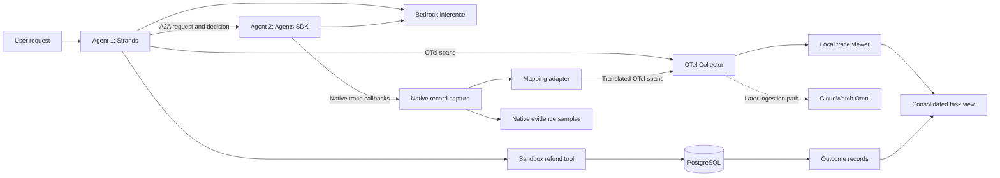

# Two-agent consolidated observability — specification v2

Status: checkpoint 1 implemented and verified with live Bedrock inference. Review the local Agent 1 evidence before proceeding to Agent 2. No AWS runtime or observability backend has been deployed.

## 1. Objective and agreed decisions

Demonstrate how two independently running agents with different instrumentation systems collaborate on one business task, and how their evidence becomes a coherent, inspectable task history.

Agreed:

- Use case: refund eligibility and execution, with synthetic orders and sandbox transactions.
- Agent 1: Python Strands, Bedrock inference, OTel-based observability.
- Agent 2: Python OpenAI Agents SDK, Bedrock inference through a model adapter, SDK-native tracing.
- AWS source Region: `us-east-1` for both agents.
- Confirmed model: Claude Sonnet 5.5, profile `us.anthropic.claude-sonnet-5-5`, source Region `us-east-1`. Profile ACTIVE verified through Bedrock GetInferenceProfile. Live Strands calls were successful.
- Communication: A2A between the agents, from their first real integration.
- Delivery: Agent 1 first; inspect and map its actual telemetry before proceeding.
- Inspection: local trace viewer first; CloudWatch Omni consolidation later.
- Native evidence remains inspectable before and after conversion.

Checkpoint 1 local components: SQLite sandbox, direct OTel JSON SpanExporter and standalone interactive trace inspector. Docker was not available. Collector/OTLP transport and CloudWatch Omni integration are later checkpoints; PostgreSQL/Jaeger remain optional alternatives, not deployed components.

The prototype uses real Bedrock inference once model access is established. Deterministic fixtures support tests without making model calls. No real payment provider is connected.

## 2. Business workflow and responsibilities

1. User requests a refund for a synthetic order.
2. Agent 1 reads the order and creates a business task ID.
3. Agent 1 requests an eligibility assessment from Agent 2 over A2A.
4. Agent 2 retrieves a versioned policy and order facts, calls a deterministic eligibility tool, and returns a structured decision with evidence references.
5. Agent 1 validates the returned decision and required evidence.
6. An allowed decision permits the refund tool to write one sandbox refund transaction. A denied decision produces a recorded refusal. Missing or invalid evidence produces an explicit failure, not a refund.
7. Agent 1 confirms the committed database state and returns the result.

Agent 2 cannot execute refunds. The refund tool independently validates its prerequisites. The model does not have unrestricted database access. The deterministic tool and database state establish the expected result against which observable agent behaviour is checked.

Proposed fixture policy: an order is eligible within a configured return window if it has not already been refunded and its status permits refund. Policy window, test amounts and version labels are illustrative fixture data.

A denied refund can be a successful business task: the outcome records whether the correct decision/action occurred, separately from transport and tool errors.

## 3. Architecture

This is the proposed logical architecture. AWS ingestion, authentication and required field mappings will be validated before the CloudWatch phase. AgentCore Runtime is optional and does not enter the first milestone.

A consolidated task view means both agents, the handoff, the refund action and its verified outcome can be investigated using one business task ID. It does not require forcing every interaction into one trace.

## 4. Agent 1: instrumentation plan

| Mechanism | Capture location | Intended evidence |
|---|---|---|
| Framework-generated OTel | Strands execution | Agent invocation, model calls and tool activity exposed by the installed SDK |
| Library auto-instrumentation | PostgreSQL client, HTTP client when introduced | SQL/client timing, status and downstream calls |
| Manual spans | Request entry, decision validation, refund transaction | Domain operation timing and errors outside existing framework spans |
| Manual events | Decision received, validation result, post-commit confirmation | Policy/evidence checks and confirmed actions |
| Extensions | Approved context on automatic/manual spans | Task/session/attempt IDs, policy version, agent version, decision/transaction references |

Use the OTel public API for custom spans. Prevent overlapping instrumentors from recording the same operation twice. Wrap refund transaction logic with a business span while allowing the SQL client instrumentor to create child SQL spans.

Baggage demonstration: propagate an allowlisted opaque business task ID at a controlled request boundary and explicitly copy it to required span attributes. Baggage is context, not authentication or authorisation. Validate incoming values.

Initial capture policy: retain all synthetic fixture traces to make comparison reliable. Do not include secrets. Test failure and shutdown/export behaviour. Later production sampling/retention is a separate design decision.

## 5. Agent 2: native tracing plan

- Keep Agents SDK tracing enabled.
- Replace the default processor/export configuration with our custom processor; do not add it alongside an unintended default OpenAI exporter.
- Capture native trace/span records in a local inspection format.
- Preserve original trace IDs, span IDs, parent IDs, timestamps, metadata and available usage/error information.
- Verify which fields the selected Bedrock adapter actually supplies, including tool calling and token usage.
- Do not add a second OTel agent instrumentor to Agent 2 merely to bypass the native mapping problem.
- A2A transport/server boundary spans may be captured separately and clearly labelled.

Bedrock model inference and the tracing export destination are separate configurations. The intended prototype sends no inference or native tracing traffic to OpenAI; this must be verified in the installed integration, not assumed.

## 6. Identity and A2A contract

Proposed enterprise/application namespace: `app.*`. These fields are custom, not claims of standard OTel keys.

| Identity | Role |
|---|---|
| `app.session.id` | Related user interactions |
| `app.task.id` | Entire refund workflow |
| `app.attempt.id` | A particular execution attempt |
| OTel trace/span IDs | Execution correlation |
| Native trace/span IDs | Source identity retained by the adapter |
| A2A context ID | Related protocol interactions |
| A2A task ID | The eligibility task owned by Agent 2 |
| Decision/transaction ID | Business evidence and committed action |

The coordinator's business task and the specialist's A2A task are different identifiers. Maintain an explicit relationship rather than equating them.

Request content: synthetic order reference, refund reason, business task/attempt correlation and contract version.

Decision artifact: eligibility decision, policy version, evidence references, reason code, decision ID and schema version. Timing and status belong in protocol/execution evidence; decision prose alone is insufficient.

Use the selected A2A SDK's supported message/artifact structures. Pin the protocol/SDK version. Verify context propagation and terminal/error states. Do not assume an Agents SDK in-process handoff is an A2A interaction.

## 7. Native-to-OTel mapping

The mapping is authored after native samples exist. Initial rules:

- Source native trace maps to a translated OTel trace; native spans map to translated OTel spans with original parent structure.
- Create valid OTel identifiers using a deterministic, collision-checked source mapping. Do not pass arbitrary native ID strings into OTel IDs.
- Map documented operation kinds, timestamps, statuses and available usage explicitly. Preserve source values when semantics differ.
- Retain original IDs and mapping version in attributes and a inspectable mapping manifest.
- Correlate the translated root to the caller's A2A boundary span using the captured context and a span link where appropriate.
- Share business task/attempt identifiers across both agents.
- Flag missing parents, unmapped operation kinds, missing usage and incomplete exports.
- Make repeated ingestion idempotent; distinguish retransmission from a genuine new agent attempt.

Default design: linked traces with a shared task view. We may evaluate a single stitched trace later, but will not rewrite parentage to create an unjustified execution tree. A trace viewer's span-link navigation and task search must be tested. A lightweight task index/view supplies joins that the selected viewer cannot display directly.

## 8. Consolidated view

For a task, display:

- Both agents and each instrumentation source.
- Timeline/trajectory, including A2A handoff and retries.
- Navigable trace/span references and original native IDs.
- Policy and decision evidence.
- Refund transaction and authoritative outcome.
- Available model usage, with missing usage clearly marked.
- Capture/mapping gaps and adapter/export failures.

Separate usage from monetary cost: token counts do not establish billed cost. Cost attribution comes after model/pricing configuration and available billing evidence are defined. A full evaluation platform is outside the initial prototype.

## 9. Build checkpoints and acceptance criteria

| Checkpoint | Scope | Required evidence before proceeding |
|---|---|---|
| 0 — Design | Agree spec, fixtures, model/Region and local infrastructure | Responsibilities, A2A schema and expected outcomes are clear |
| 1 — OTel agent (verified) | Agent 1, Bedrock, tools, SQLite, direct local export | Actual span tree; automatic/manual/extended coverage labelled; success/denial/DB error evidence; verified commit |
| 2 — Native agent | Agent 2, Bedrock adapter, native processor | Native samples for success/tool/provider error; usage coverage documented; no unintended OpenAI export |
| 3 — A2A | Connect independently running agents | Request/artifact lifecycle, cross-agent ID mapping, timeout/retry behaviour and incomplete responses visible |
| 4 — Mapping and consolidation | Adapter and local consolidated task view | Native parents/timestamps preserved; linked traces; no duplicate exports; outcome attached; gaps visible |
| 5 — AWS destination | CloudWatch Omni integration | Ingestion and task/session conventions verified; both agent sources queryable; required correlation remains navigable |
| 6 — Runtime decision | Evaluate AgentCore deployment | Identify benefit and coverage changes, then deploy only within the agreed scope |

Checkpoint 1 uses an explicitly labelled eligibility fixture while Agent 2 does not exist. This validates Agent 1 independently; it is not presented as a real A2A interaction. Replace the fixture with the actual A2A client at checkpoint 3.

Each checkpoint produces inspectable sample records, a coverage/mapping table and a short verification report. Review the evidence together before advancing. Do not build all phases in one run.

Required scenarios over the full prototype: eligible refund, correctly denied refund, repeated request without duplicate transaction, provider error, tool/DB failure, A2A timeout, invalid policy evidence, missing native record, and telemetry export interruption. Recovery tests must state any lost evidence.

## 10. Open interview decisions

1. Model decision resolved: Sonnet 5.5, `us.anthropic.claude-sonnet-5-5`, `us-east-1`. Live execution validated for Agent 1; Agent 2 adapter compatibility remains a separate checkpoint.
2. Local runtime resolved for checkpoint 1: no Docker found; SQLite plus standalone viewer implemented. Choose the collector/backend path when moving beyond direct local SDK export.
3. Exact fixture policy and which injected failure to demonstrate first. Default: eligible and denied cases, followed by database failure.

No credentials should be pasted into the specification or chat. Authentication is configured separately when live inference starts.

## 11. Primary documentation

These establish integration capabilities, not proof that this prototype has been implemented:

- Strands tracing: https://strandsagents.com/docs/user-guide/sdk/observability-evaluation/traces/
- Agents SDK native tracing/processors: https://openai.github.io/openai-agents-python/tracing/
- Agents SDK third-party model adapters: https://openai.github.io/openai-agents-python/models/
- LiteLLM Bedrock provider: https://docs.litellm.ai/docs/providers/bedrock
- A2A task/context lifecycle: https://a2a-protocol.org/latest/topics/life-of-a-task/
- Jaeger deployment: https://www.jaegertracing.io/docs/latest/deployment/
- OTel Collector: https://opentelemetry.io/docs/collector/architecture/
- CloudWatch Omni ingestion: https://docs.aws.amazon.com/AmazonCloudWatch/latest/monitoring/omni-send-telemetry.html

## Checkpoint 1 evidence

See `agent1/README.md`, `agent1/inspection.html` and `agent1/coverage.json`. Eligible, denied and SQL-error rollback cases were executed with real Sonnet inference. Every final span has task/session/attempt context; framework, SQL and manual business capture are present. Seven domain tests passed. Agent 2, A2A, native mapping and AWS ingestion are intentionally still pending.
