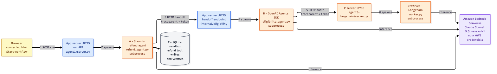
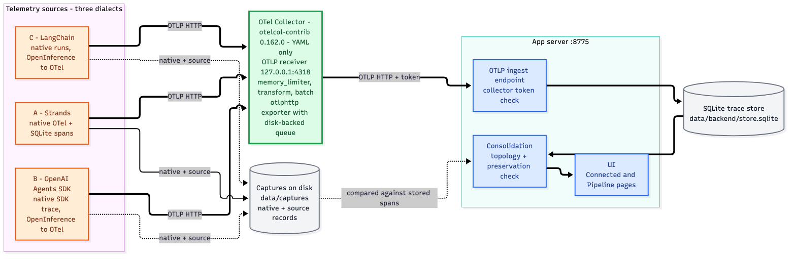

# Observability, step by step: three frameworks, one OpenTelemetry trace, one Collector

This guide explains exactly how telemetry flows in this solution, grounded in the
real code. It covers five things in order:

1. The problem — three agents, three telemetry formats.
2. How OpenInference converts non-OpenTelemetry frameworks to OpenTelemetry, in code.
3. How each agent is configured to send data to the Collector.
4. How the three separate agents become one trace.
5. How the Collector is configured, how it transforms the data, and how it pushes
   to the target.

Every code excerpt below is quoted from the actual files, with the file path
given. Nothing is paraphrased.

> **Just want to run it?** See [RUNNING.md](RUNNING.md) for the one-command local
> quick start, prerequisites, and troubleshooting. This document explains how the
> observability works; RUNNING.md explains how to start it.

---

## 0. The cast

| Agent | File | Framework | Service name (its identity in the trace) |
|---|---|---|---|
| A | `app/agent1/refund_agent.py` | Strands | `refund-coordinator-strands` |
| B | `app/agent2/eligibility_agent.py` (+ `agent2/bridge_capture.py`) | OpenAI Agents SDK | `refund-eligibility-native` |
| C | `app/agent3-langchain/worker.py` | LangChain | `refund-policy-auditor-langchain` |

Shared pieces:
- `app/pipeline/transport.py` — the one helper every agent uses to attach the OTLP exporter.
- `app/pipeline/collector.yaml` — the entire Collector configuration (no custom code).
- The launcher `app/agent3-langchain/start_demo.py` → `app/pipeline/start.py` — sets
  the Collector address and starts everything.

The business workflow: A (refund coordinator) calls B (eligibility) over HTTP, and
B calls C (policy auditor) over HTTP. All three call Amazon Bedrock for inference.

**How a workflow runs:**



**Where the telemetry goes:**



---

## 1. The problem: three telemetry formats

Only Strands emits OpenTelemetry natively. The OpenAI Agents SDK and LangChain each
have their own internal tracing model:

- Agents SDK produces native **SDK trace objects**.
- LangChain produces native **Run objects**.

Neither is OpenTelemetry. To get all three into one standard pipeline, B and C must
be converted to OpenTelemetry. The converter is **OpenInference** — an open-source
instrumentation library, one package per framework. You install it and enable it;
you do not write any conversion code.

---

## 2. How OpenInference works, in the code

OpenInference hooks a framework's internal callbacks and emits standard
OpenTelemetry spans onto a tracer provider you give it.

### Agent C — LangChain (`app/agent3-langchain/worker.py`)

```python
# The OpenInference instrumentor for LangChain. Importing it does nothing on its
# own; it must be enabled against a tracer provider (below).
from openinference.instrumentation.langchain import LangChainInstrumentor, get_current_span

def configure(output, ids):
    # A TracerProvider is the OpenTelemetry object that creates spans and holds
    # the pipeline that decides where they go. 'resource' is metadata attached to
    # EVERY span from this provider; service.name is how this agent appears as a
    # distinct service in the final trace.
    provider = TracerProvider(resource=Resource.create(
        {'service.name': SERVICE, 'telemetry.capture': 'openinference-langchain'}))

    # A "span processor" runs on every span as it starts/ends. Annotations stamps
    # the business IDs (app.workflow.id, etc.) onto each span — see section 4b.
    provider.add_span_processor(Annotations(ids))

    # A second processor that writes each span to a local JSON file ('capture'),
    # used only for the offline "nothing was lost" comparison, not for live flow.
    provider.add_span_processor(SimpleSpanProcessor(capture))

    # This is the line that points the provider at the Collector. "Attaches the
    # OTLP exporter" means: add a span processor whose exporter POSTs spans, in
    # OTLP format, to the Collector address in OBSERVABILITY_OTLP_ENDPOINT. See
    # section 3b for the exact body of configure_otlp().
    configure_otlp(provider, output)

    # Create the instrumentor, then ENABLE it. instrument() hooks LangChain's
    # internal callbacks so that from now on every LangChain model/tool/chain
    # step is automatically emitted as an OpenTelemetry span on THIS provider.
    # This is the whole native->OTel bridge; no conversion code is written.
    instrumentor = LangChainInstrumentor()
    instrumentor.instrument(tracer_provider=provider,
                            separate_trace_from_runtime_context=False)
    return provider, capture, instrumentor
```

The single line `instrumentor.instrument(tracer_provider=provider)` is the entire
bridge. After it runs, every LangChain model call, tool call, and chain step is
emitted as an OpenTelemetry span on `provider`. The agent then simply runs:

```python
response = agent.invoke({'messages': [...]}, config={'callbacks': [native], 'recursion_limit': 10})
```

and the spans are produced automatically. At shutdown the worker calls
`instrumentor.uninstrument()` to unhook cleanly.

### Agent B — OpenAI Agents SDK (`app/agent2/bridge_capture.py`)

```python
# The OpenInference instrumentor for the OpenAI Agents SDK.
from openinference.instrumentation.openai_agents import OpenAIAgentsInstrumentor

def enable_bridge(output, ids):
    # Same as agent C: a provider whose service.name marks this agent in the trace.
    provider = TracerProvider(resource=Resource.create(
        {'service.name': 'refund-eligibility-native',
         'telemetry.capture': 'openinference-runtime-bridge'}))

    # Stamp business IDs onto every span (section 4b).
    provider.add_span_processor(SourceAnnotations(ids, live_spans))

    # Write each OTel span to a local file for the offline comparison.
    provider.add_span_processor(SimpleSpanProcessor(exporter))

    # Attach the OTLP exporter -> send spans to the Collector (section 3b).
    from transport import configure_otlp
    configure_otlp(provider, output)

    # Keep a copy of the SDK's NATIVE trace records on disk (the "before"
    # version, pre-conversion). Used only later to prove the bridge lost nothing;
    # it is NOT part of the live telemetry path.
    set_trace_processors([capture])

    # Enable the bridge: hook the Agents SDK so its native trace objects are
    # emitted as OpenTelemetry spans on THIS provider. exclusive_processor=False
    # lets our capture coexist rather than replacing the SDK's processors.
    OpenAIAgentsInstrumentor().instrument(
        tracer_provider=provider, exclusive_processor=False)
    return capture, exporter, provider
```

Same pattern: `OpenAIAgentsInstrumentor().instrument(...)` converts the SDK's native
trace into OpenTelemetry spans on `provider`. The extra `set_trace_processors([capture])`
keeps a copy of the raw SDK records on disk — used **only** later to prove the bridge
lost nothing, not part of the live pipeline.

### Agent A — Strands (`app/agent1/refund_agent.py`)

Strands is already OpenTelemetry, so there is no OpenInference. Agent A builds a
plain OpenTelemetry provider and lets the SDK and framework emit spans:

```python
# Build the tracer provider. No OpenInference here — Strands already produces
# OpenTelemetry spans itself, so this provider simply collects them.
provider = TracerProvider(resource=Resource.create({
    "service.name": "refund-coordinator-strands",     # this agent's identity in the trace
    "service.version": "checkpoint-1",
    "deployment.environment.name": "local-sandbox",
}))

# Stamp the business IDs (app.task.id, app.session.id, ...) onto every span
# (section 4b).
provider.add_span_processor(ContextExtensions())

# Write each span to a local JSON file for the offline comparison.
provider.add_span_processor(SimpleSpanProcessor(exporter))

# Attach the OTLP exporter -> send spans to the Collector (section 3b).
from transport import configure_otlp
configure_otlp(provider, path.parent)

# Register this provider as the global default, so Strands and any library that
# asks OpenTelemetry for a tracer gets THIS provider.
trace.set_tracer_provider(provider)

# Auto-instrument the sqlite3 library: every SQL statement this agent runs
# against its sandbox DB becomes a child span automatically. This is the SAME
# idea as OpenInference (a library that emits spans for you), just for SQLite.
SQLite3Instrumentor().instrument(tracer_provider=provider)
```

**Key point:** the conversion for B and C happens inside the agent process, as a
library call, with no hand-written adapter. That is why this solution contains no
custom native-to-OpenTelemetry mapping code.

---

## 3. How each agent is configured to send data to the Collector

### 3a. The launcher sets the Collector address once

`app/agent3-langchain/start_demo.py` injects the endpoint as an environment variable
into every agent subprocess:

```python
env = {**os.environ,
       'PIPELINE_APP_PORT': '8775',
       'AGENTC_PORT': '8786', 'AGENTC_ENDPOINT': 'http://127.0.0.1:8786/audit',
       'AGENTC_TOKEN': secrets.token_hex(24),
       'OBSERVABILITY_OTLP_ENDPOINT': 'http://127.0.0.1:4318/v1/traces'}
```

`OBSERVABILITY_OTLP_ENDPOINT = http://127.0.0.1:4318/v1/traces` is the Collector's
OTLP-over-HTTP receiver. `4318` is the Collector; `/v1/traces` is the standard OTLP
path. There is **no Collector address hardcoded in any agent** — it comes only from
this one variable.

### 3b. Every agent attaches the exporter through one helper

`app/pipeline/transport.py`:

```python
def configure_otlp(provider, output):
    # Read the Collector address that the launcher put in the environment.
    # (e.g. http://127.0.0.1:4318/v1/traces). Nothing is hardcoded here.
    endpoint = os.environ.get('OBSERVABILITY_OTLP_ENDPOINT')

    # If no endpoint is set, do nothing: the agent still runs, it just does not
    # export spans anywhere. This is why the agents work with or without a Collector.
    if not endpoint:
        return None

    # Create the exporter: the component that actually serializes spans to the
    # OTLP wire format and HTTP-POSTs them to 'endpoint'. AuditedOTLPExporter is
    # a thin wrapper around the stock OTLPSpanExporter(endpoint=...) that also
    # records which span IDs the Collector accepted (for the preservation check).
    exporter = AuditedOTLPExporter(endpoint, Path(output) / 'otlp-export.json')

    # "Attach the exporter" = wrap it in a SpanProcessor and add it to the
    # provider's pipeline. From now on, every span this provider finishes is
    # handed to this exporter, which sends it to the Collector. THIS is the line
    # that makes the agent's spans leave the process and reach the Collector.
    provider.add_span_processor(SimpleSpanProcessor(exporter))
    return exporter
```

So "attaches the OTLP exporter" means precisely: it adds a span processor whose
exporter POSTs every finished span, in OTLP format, to the Collector address from
`OBSERVABILITY_OTLP_ENDPOINT`. `AuditedOTLPExporter` is the stock
`OTLPSpanExporter(endpoint=...)` plus a record of which span IDs the Collector
accepted (used only for the preservation check).

Each agent calls this helper when it builds its provider:
- A: `configure_otlp(provider, path.parent)`
- B: `configure_otlp(provider, output)`
- C: `configure_otlp(provider, output)`

**Result:** all three agents export OpenTelemetry over HTTP to the Collector on
`127.0.0.1:4318`. To change the destination, you change this one environment
variable or the Collector's own exporter — never agent code.

---

## 4. How three separate agents become one trace

Two mechanisms stitch the three independent processes into a single trace.

### 4a. W3C context across the HTTP handoffs

When A calls B, and B calls C, the caller injects the W3C `traceparent` header and
the receiver extracts it, opening its span under that remote context.

Caller side (A → B), `app/agent1/refund_agent.py`, and (B → C), `app/agent3/caller.py`:

```python
# Normal HTTP headers for the outbound call.
headers = {'Content-Type': 'application/json', 'X-AgentC-Token': os.environ['AGENTC_TOKEN']}

# inject() writes the CURRENT span's identity into 'headers' as the W3C
# "traceparent" header (a string like 00-<trace_id>-<span_id>-01). This is how
# the current trace context travels to the next service over HTTP.
TraceContextTextMapPropagator().inject(headers)
```

Receiver side (C), `app/agent3-langchain/worker.py`:

```python
# extract() reads the incoming "traceparent" header back into an OTel context
# object, recovering the caller's trace_id and the caller's span as parent.
remote = TraceContextTextMapPropagator().extract(request['trace_headers'])

# Open this service's first span UNDER that remote context. Because context=remote,
# this span becomes a CHILD of the caller's span, so it inherits the same trace_id.
# kind=SERVER marks it as the inbound side of a service boundary.
with provider.get_tracer('policy-audit.http', '1.0').start_as_current_span(
        'agent3.policy.audit.receive', context=remote, kind=trace.SpanKind.SERVER) as boundary:
    ...
```

Because the receiver opens its SERVER span under the extracted context, C's spans
become children of B's, and B's of A's. One trace ID spans all three services.

### 4b. Business identity stamped on every span

Each agent attaches a span processor that copies allowlisted business IDs onto every
span it creates. Agent A uses `ContextExtensions` (`app/agent1/refund_agent.py`):

```python
# The business identifiers we want on every span so the UI can correlate agents.
FIELDS = ("app.task.id", "app.session.id", "app.attempt.id", "app.run.id",
          "app.scenario", "app.model.mode", "app.workflow.id")

# on_start runs automatically as each span begins (this class is a SpanProcessor).
def on_start(self, span, parent_context=None):
    for key in self.FIELDS:
        # "baggage" is OTel's key/value bag that rides along with the context.
        # Read each business ID from baggage and copy it onto the span as an
        # attribute, so it is queryable later.
        value = baggage.get_baggage(key, context=parent_context)
        if value is not None:
            span.set_attribute(key, value)
    # Two fixed attributes identifying the policy and agent version.
    span.set_attribute("app.policy.version", POLICY_VERSION)
    span.set_attribute("app.agent.version", "checkpoint-1")
```

B and C do the equivalent through `SourceAnnotations` / `Annotations`. These
`app.workflow.id`, `app.session.id`, `app.handoff.id` attributes let the consolidation
layer correlate the agents and verify the cross-service boundaries, even where no
parent edge exists.

---

## 5. The Collector: configuration, transforms, and push to target

The Collector is the stock open-source binary `otelcol-contrib` version 0.162.0.
There is **no custom code** — the entire behavior is `app/pipeline/collector.yaml`.

### 5a. Receiver — where telemetry comes in

```yaml
receivers:
  otlp:                      # the standard OpenTelemetry receiver
    protocols:
      http:                  # accept OTLP over HTTP (the agents use the HTTP exporter)
        endpoint: 127.0.0.1:4318   # listen here; this is exactly what the agents POST to
```

This is the exact address the agents target (section 3a).

### 5b. Processors — what happens to the data, in order

```yaml
processors:
  memory_limiter:            # safety valve: drop data before the Collector runs out of RAM
    check_interval: 1s       # check memory every second
    limit_mib: 128           # hard ceiling
    spike_limit_mib: 32      # start shedding 32 MiB below the ceiling
  transform/semantics:       # rewrite/normalize span attributes (see 5c)
    # ... see 5c
  batch:                     # group spans before export for efficiency
    timeout: 250ms           # flush at least every 250 ms...
    send_batch_size: 32      # ...or sooner once 32 spans are queued
```

`memory_limiter` runs first to shed load before the Collector can run out of memory.
`batch` runs last to group spans efficiently before export.

### 5c. The transforms — making three dialects into one

`transform/semantics` runs OTTL (OpenTelemetry Transformation Language) statements
over every span. Two jobs.

**Job 1 — normalize OpenInference attributes to the standard `gen_ai.*` names.**
OpenInference names token counts `llm.token_count.prompt`; the standard is
`gen_ai.usage.input_tokens`. The full block from `collector.yaml`:

```yaml
trace_statements:
  - context: span                                  # these rules run on each span
    statements:
      # Tag every span so we can prove it passed through this Collector version/policy.
      - set(attributes["app.pipeline.version"], "collector-v1")
      - set(attributes["app.data.policy"], "collector-content-policy-v1")

      # For spans that OpenInference marked as an LLM call to a Bedrock Claude
      # model, add the standard provider/cloud attributes. The `where` clause is
      # the condition; it only fires on matching LLM spans.
      - set(attributes["llm.system"], "anthropic") where attributes["openinference.span.kind"] == "LLM" and IsMatch(attributes["llm.model_name"], "^bedrock/converse/.*claude")
      - set(attributes["gen_ai.provider.name"], "anthropic") where attributes["openinference.span.kind"] == "LLM" and IsMatch(attributes["llm.model_name"], "^bedrock/converse/.*claude")
      - set(attributes["cloud.provider"], "aws") where attributes["openinference.span.kind"] == "LLM" and IsMatch(attributes["llm.model_name"], "^bedrock/converse/.*claude")
      - set(attributes["cloud.region"], "us-east-1") where attributes["openinference.span.kind"] == "LLM" and IsMatch(attributes["llm.model_name"], "^bedrock/converse/.*claude")
      - set(attributes["app.model.serving_platform"], "amazon-bedrock") where attributes["openinference.span.kind"] == "LLM" and IsMatch(attributes["llm.model_name"], "^bedrock/converse/.*claude")

      # THE KEY NORMALIZATION: OpenInference names token counts
      # llm.token_count.prompt/completion. Copy them into the STANDARD OTel GenAI
      # names gen_ai.usage.input_tokens/output_tokens, so any backend reads tokens
      # the same way no matter which framework produced the span. `!= nil` means
      # "only when the source attribute exists".
      - set(attributes["gen_ai.usage.input_tokens"], attributes["llm.token_count.prompt"]) where attributes["llm.token_count.prompt"] != nil
      - set(attributes["gen_ai.usage.output_tokens"], attributes["llm.token_count.completion"]) where attributes["llm.token_count.completion"] != nil
```

After this, a model-call span from LangChain and one from Strands carry the same
`gen_ai.*` attributes, so a backend reads tokens and provider identically regardless
of source.

**Job 2 — strip content (governance, in config).** Delete prompts, completions, and
tool payloads before they leave for the store:

```yaml
      # delete_matching_keys removes every attribute whose NAME matches this
      # regex. The regex lists the content-bearing fields: prompt/response text
      # (input.value, output.value, the message arrays) and tool arguments/results.
      # This is governance done in config: sensitive content is stripped before
      # the span leaves for the store.
      - delete_matching_keys(attributes, "^(input\\.value|output\\.value|llm\\.(input_messages|output_messages)\\..*|gen_ai\\.tool\\.call\\.(arguments|result)|tool\\.parameters|gen_ai\\.tool\\.json_schema|gen_ai\\.(system_instructions|input\\.messages|output\\.messages))$")
  - context: spanevent          # spans can carry "events"; strip content from those too
    statements:
      - delete_matching_keys(attributes, "^gen_ai\\.(system_instructions|input\\.messages|output\\.messages)$")
```

In a verified eligible run this removed 154 content fields with zero remaining.
(Note: a backend that should show prompts/completions, such as Langfuse, needs a
separate pipeline branch WITHOUT this deletion — see section 7.)

### 5d. Exporter and push to the target

```yaml
exporters:
  otlphttp/store:                                   # the exporter that leaves the Collector
    endpoint: ${env:PIPELINE_APP_URL}/internal/otlp # target URL (from env); here the app server's ingest
    compression: none
    headers:
      X-Collector-Token: ${env:PIPELINE_INGEST_TOKEN}  # shared secret so the target trusts the Collector
    retry_on_failure:          # if the target is down, retry instead of dropping
      enabled: true
      initial_interval: 1s     # first retry after 1s
      max_interval: 5s         # back off up to 5s between retries
      max_elapsed_time: 30s    # give up after 30s total
    sending_queue:             # buffer spans so a target hiccup does not lose data
      enabled: true
      num_consumers: 1
      queue_size: 1000         # hold up to 1000 batches
      storage: file_storage    # persist the queue to disk (survives Collector restart)
```

The `batch` processor hands grouped spans to this exporter, which POSTs them to the
target (today the app server's `/internal/otlp` ingest endpoint, protected by a
token). On failure it retries with backoff for up to 30 s, buffering in a
**file-backed queue** so a target outage does not drop data.

### 5e. The pipeline — wiring it together

```yaml
service:
  extensions: [health_check, file_storage]   # turn on the readiness probe + the durable queue backend
  pipelines:
    traces:                                   # one pipeline for the traces signal
      receivers: [otlp]                       # in: from the OTLP receiver (5a)
      processors: [memory_limiter, transform/semantics, batch]  # run IN THIS ORDER
      exporters: [otlphttp/store]             # out: to the target (5d)
  telemetry:
    logs:
      level: info                             # the Collector's own logs
    metrics:
      level: none                             # the Collector's own metrics off (not needed here)
```

One traces pipeline: OTLP in → protect, transform, batch → export. The `file_storage`
and `health_check` extensions back the durable queue and the readiness probe on
`:13133`.

---

## 6. End-to-end, in one paragraph

The launcher sets `OBSERVABILITY_OTLP_ENDPOINT` to the Collector. Each agent builds
an OpenTelemetry tracer provider with its own `service.name`; Strands emits spans
natively while OpenInference instruments the Agents SDK and LangChain in-process, and
all three attach the standard OTLP exporter via `transport.py:configure_otlp()`. The
agents stitch one trace across their HTTP handoffs with W3C `traceparent` and stamp
shared `app.*` business IDs on every span. All spans flow to the stock open-source
Collector on `127.0.0.1:4318`, whose `collector.yaml` normalizes OpenInference
attributes to `gen_ai.*`, strips content, batches, and pushes to the target through a
retrying, disk-backed queue. The result, verified in a live run, is one trace of 50
spans across all three services, with both cross-service boundaries recorded and real
Bedrock token counts preserved.

---

## 7. Sending the same telemetry to a different target (e.g. Langfuse)

Only the Collector exporter and pipeline change — **no agent code changes**, because
the agents only ever talk to the Collector. This repo already ships that change as a
second, non-destructive Collector configuration:

- `app/pipeline/collector-langfuse.yaml` — keeps the original SQLite store pipeline
  **and** adds a second pipeline whose branch normalizes attributes but does **not**
  run the content-stripping statements (so prompts and completions still appear in
  Langfuse), exporting OTLP to the Langfuse OTLP endpoint with its `Authorization`
  header.
- `scripts/run_langfuse.py` — launches the stack with that config instead of the
  default. It reads Langfuse credentials from this folder's own `.env`
  (see `.env.example`).

Because this lives entirely in Collector configuration, the original
`collector.yaml`, the SQLite store, and all three agents are untouched. This was
verified live: a run produced a Langfuse trace of 50 observations with computed cost,
proving the token normalization carried through to the backend.
