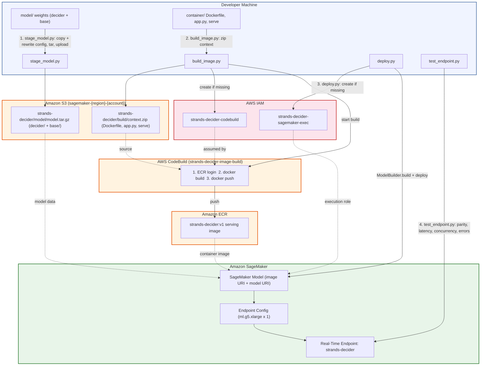
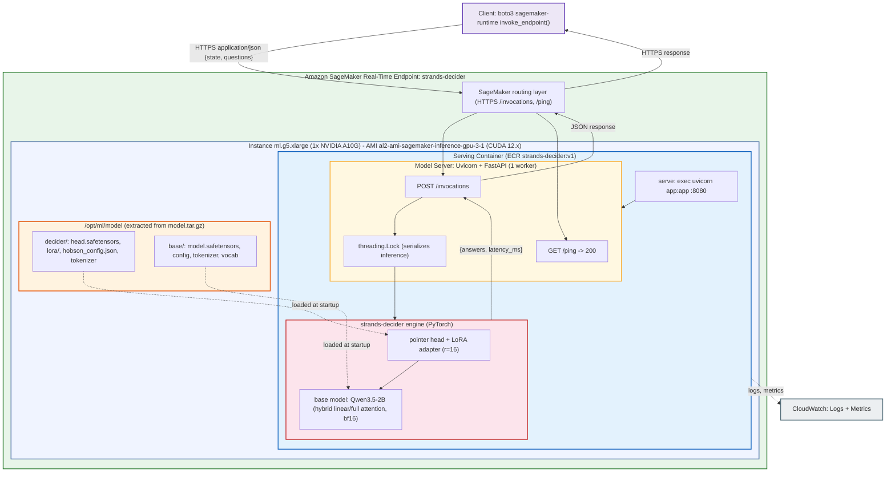

# Strands Decider on SageMaker

Deploy the **Strands Decider** model (a 2B-parameter classification/decision model,
`strands-decider-2B-hobson-v19`) as a real-time Amazon SageMaker endpoint.

Unlike a generative LLM, the Decider answers *structured* questions about a piece of text
(the `state`). You hand it a state plus one or more typed questions and it returns calibrated
probabilities and choices. There are three question types:

- **`choice`** — pick one option from a set of labeled criteria (returns the chosen label,
  a confidence, and a probability per option).
- **`noul`** — a yes/no judgment (returns `P(true)`).
- **`score`** — an ordinal rating across an ordered list of levels.

The serving container wraps the model's own inference engine in a FastAPI app behind the
SageMaker contract (`GET /ping`, `POST /invocations` on port 8080) — see
[`container/app.py`](container/app.py).

---

## Architecture

### Build & deploy pipeline

The four deployment scripts coordinate across S3, CodeBuild, ECR, IAM, and SageMaker. The
numbered steps map 1:1 to the [deployment sequence](#deployment-sequence) below.



### SageMaker endpoint anatomy

What actually runs when a request arrives, from the outside in — routing layer, GPU host,
container, model server, and the model itself:



---

## Repository layout

```
decider-sagemaker/
├── container/              # the serving image
│   ├── Dockerfile          #   torch cu126 + strands-decider + transformers + peft
│   ├── app.py              #   FastAPI wrapper: /ping, /invocations, warmup, serialized inference
│   └── serve               #   entrypoint: uvicorn app:app on :8080
├── model/                  # local model weights (git-ignored, large)
│   ├── decider/            #   the Decider checkpoint (head, LoRA adapter, config, tokenizer)
│   └── base/               #   the base model (Qwen3.5-2B-Base)
├── tests/
│   ├── requests.json       #   sample requests exercising choice / noul / score / multi-question
│   ├── golden.json         #   CPU reference answers (git-ignored or committed; see make_golden.py)
│   └── test_app_local.py   #   local app tests
├── usecases/               # 11 runnable end-to-end examples against the live endpoint
├── build/                  # generated artifacts (git-ignored): model.tar.gz, *_uri.txt, logs
│
├── stage_model.py          # 1. package weights -> model.tar.gz -> S3
├── build_image.py          # 2. build & push the serving image via CodeBuild
├── deploy.py               # 3. create IAM role + model + endpoint
├── test_endpoint.py        # 4. validate the live endpoint
├── destroy.py              # 5. tear everything down
├── make_golden.py          # (one-time) generate tests/golden.json locally
└── try_endpoint.py         # minimal single-call usage example
```

> **Run every script from the repository root.** They use relative paths
> (`build/…`, `tests/…`, `model/…`, `container/…`), so running them from another
> directory will break.

---

## Prerequisites

- **AWS account & credentials** configured locally (`aws configure` or SSO). The default
  region is `us-east-1`; override with the `AWS_REGION` environment variable.
- **IAM permissions** for the identity running these scripts to manage SageMaker, ECR,
  CodeBuild, S3, IAM, and CloudWatch Logs. (The scripts create the *execution* roles the
  services need, but your own principal must be allowed to create them.)
- **Python 3.12** with the project dependencies. A local virtual environment is expected at
  `.venv/`:
  ```bash
  python3.12 -m venv .venv
  .venv/bin/pip install boto3 sagemaker strands-decider==0.1.0 transformers==5.18.0 peft==0.21.2
  ```
- **Model weights** present under `model/decider/` and `model/base/`. These are not in git
  (too large) — obtain them from your model source and place them there before staging.
- **No local Docker required** — the image is built remotely by AWS CodeBuild.

### Key defaults (all overridable via environment variables)

| Variable | Default | Used by | Meaning |
|---|---|---|---|
| `AWS_REGION` | `us-east-1` | all | AWS region |
| `ENDPOINT_NAME` | `strands-decider` | deploy / destroy / test | endpoint name |
| `INSTANCE_TYPE` | `ml.g5.xlarge` | deploy | GPU instance for the endpoint |

Fixed names worth knowing: the ECR repo and S3 prefix are both `strands-decider`; the S3
bucket is `sagemaker-<region>-<account>`; the SageMaker execution role is
`strands-decider-sagemaker-exec`; the CodeBuild role/project are `strands-decider-codebuild`
/ `strands-decider-image-build`.

---

## Deployment sequence

Run these four steps in order from the repo root. Steps 1 and 2 are independent of each
other and can be run in either order; step 3 needs both.

### 1. Stage the model → S3

```bash
python stage_model.py
```

Copies `model/decider` and `model/base` into `build/stage/`, rewrites
`decider/hobson_config.json` so `base_model` points at `/opt/ml/model/base` (the path the
weights will live at inside the endpoint container), packs everything into
`build/model.tar.gz` (gzip level 1 for speed), and uploads it to
`s3://sagemaker-<region>-<account>/strands-decider/model/model.tar.gz`. Writes the S3 URI to
`build/model_uri.txt`.

> At runtime SageMaker extracts this archive to `/opt/ml/model`, so the container sees
> `/opt/ml/model/decider` and `/opt/ml/model/base`.

### 2. Build & push the serving image

```bash
python build_image.py [tag]      # tag defaults to "v1"
```

Idempotently creates the ECR repository, a CodeBuild service role, and a CodeBuild project if
they don't exist, zips the build context (`container/Dockerfile`, `app.py`, `serve`), uploads
it to S3, and starts a CodeBuild run that builds and pushes the image to
`<account>.dkr.ecr.<region>.amazonaws.com/strands-decider:<tag>`. Streams build phases and,
on failure, prints the tail of the CodeBuild log. Writes the image URI to
`build/image_uri.txt`.

> **Why CodeBuild instead of local Docker?** No local Docker daemon or GPU is needed, and the
> image is built in the same partition it's pushed to.

### 3. Deploy the endpoint

```bash
python deploy.py
```

Reads `build/image_uri.txt` and `build/model_uri.txt`, ensures the SageMaker execution role
`strands-decider-sagemaker-exec` exists (with scoped ECR / S3 / Logs / CloudWatch
permissions), then uses the SageMaker SDK `ModelBuilder` to create the model and deploy (or
*update*, if it already exists) the real-time endpoint. The deploy waits until the endpoint is
`InService` (up to a 900s container start timeout).

Two important runtime details baked into this step:
- `inference_ami_version="al2-ami-sagemaker-inference-gpu-3-1"` — the default GPU host AMI
  ships a CUDA 11.4 driver, but the image's torch is built for CUDA 12.6, which needs a 12.x
  driver. This AMI provides it.
- `env_vars={"DECIDER_MODEL_NAME": "strands-decider-2B-hobson-v19"}` — passed through to the
  app.

### 4. Validate

```bash
python test_endpoint.py [--endpoint strands-decider] [--calls 50]
```

Runs four checks against the live endpoint:
1. **Golden parity** — every request in `tests/requests.json` must match the CPU reference in
   `tests/golden.json` within a 0.02 tolerance (and identical `choice` picks).
2. **Latency** — serial calls; asserts server-side p50 < 300 ms.
3. **Concurrency** — 4 clients × 10 calls, all must succeed and match.
4. **Error handling** — malformed requests must be rejected.

Exits non-zero if anything fails.

For a minimal single call, see [`try_endpoint.py`](try_endpoint.py).

---

## Generating the golden reference (one-time)

`test_endpoint.py` compares the endpoint against `tests/golden.json`. Regenerate it locally
(on CPU) whenever the model or request set changes:

```bash
python make_golden.py [checkpoint] [device]   # defaults: model/decider  cpu
```

---

## Calling the endpoint

Request and response shape (from `try_endpoint.py`):

```python
import json, boto3

runtime = boto3.client("sagemaker-runtime", region_name="us-east-1")
request = {
    "state": "Help! My payouts have been failing for 3 days!",
    "questions": {
        "team": {
            "type": "choice",
            "instructions": "Which team should handle this?",
            "criteria": {
                "billing": "Payments, payouts, invoices, refunds",
                "sales": "New purchases, pricing, upgrades",
                "retail": "In-store orders and returns",
            },
        },
        "urgent": {"type": "noul", "instructions": "Is this urgent?"},
    },
}
resp = runtime.invoke_endpoint(
    EndpointName="strands-decider",
    ContentType="application/json",
    Body=json.dumps(request),
)
result = json.loads(resp["Body"].read())
# result["answers"]["team"]  -> {"choice": ..., "confidence": ..., "probabilities": {...}}
# result["answers"]["urgent"] -> {"noul": <P(true)>}
# result["latency_ms"]        -> server-side latency
```

See [`usecases/`](usecases/) for 11 end-to-end examples (ticket triage, intent routing,
tool-call gating, LLM routing, content screening, and more).

---

## Teardown

Deleting the endpoint stops the hourly instance charge. The archive in S3 and the ECR image
are cheap to keep, but the GPU endpoint is not.

```bash
python destroy.py [--endpoint strands-decider]
```

Deletes the endpoint, its endpoint config, and the backing model(s), waiting for the endpoint
to be fully removed.

---

## Troubleshooting

- **Endpoint stuck in `Creating` then `Failed`** — check CloudWatch Logs under
  `/aws/sagemaker/Endpoints/strands-decider`. The most common cause is a CUDA driver mismatch;
  confirm `inference_ami_version` in `deploy.py` is the GPU AMI noted above.
- **CodeBuild fails on first run** — IAM role propagation can lag; `build_image.py` already
  retries project creation, but re-running the script resolves transient `assume-role` errors.
- **`model_uri.txt` / `image_uri.txt` not found** — run `stage_model.py` and `build_image.py`
  before `deploy.py`.
- **Golden parity fails after a model change** — regenerate `tests/golden.json` with
  `make_golden.py`.
- **Slow first request** — the container warms up (triton kernel compile, CUDA init) during
  startup before `/ping` succeeds, so cold starts are absorbed before the endpoint reports
  `InService`.
